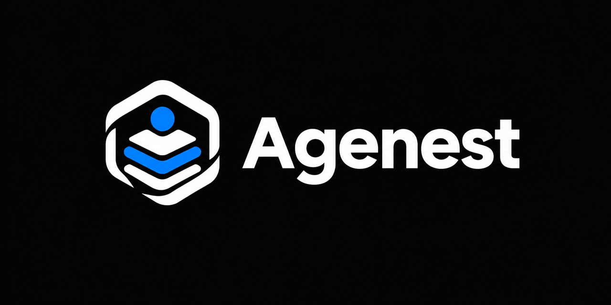
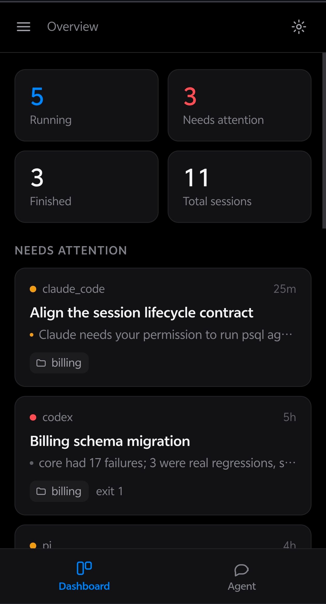
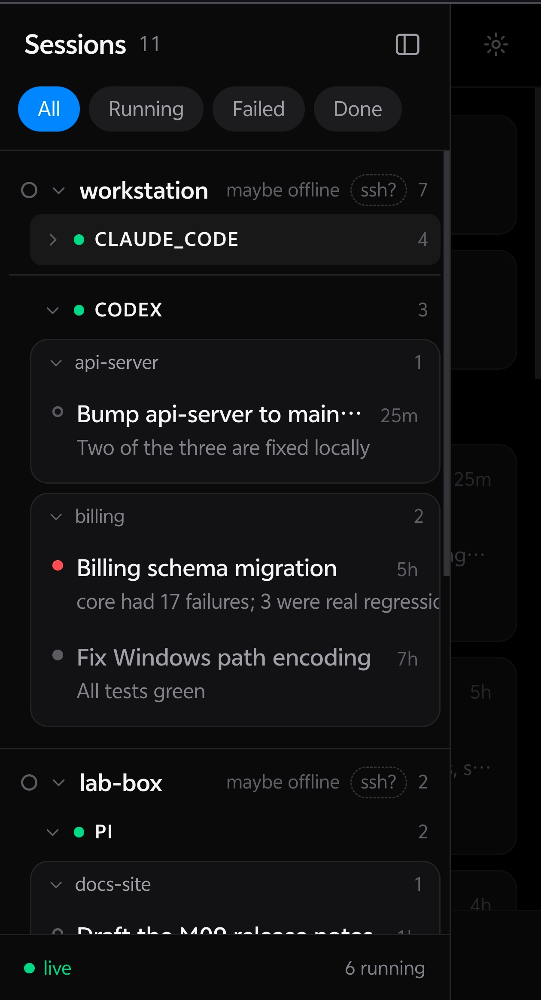
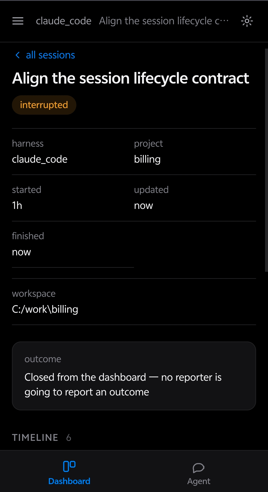
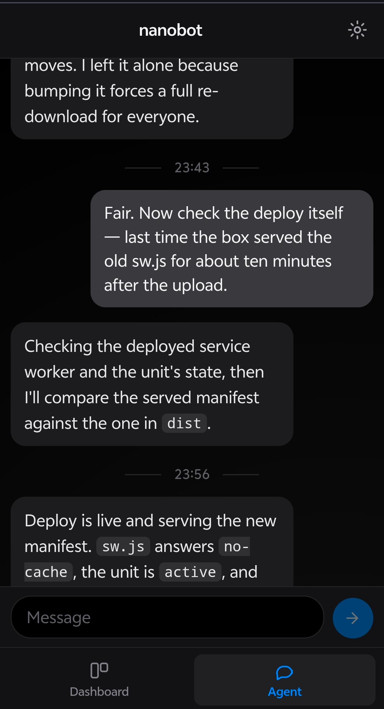

# Agenest

[English](README.md) · 简体中文



Agenest 是一个手机优先的 coding agent control plane，以 PWA 形式安装，体验接近原生 App。
它自带一个 personal agent，用来给你所有的 coding agent 指派任务和汇总进度，也可以接入你已有的
personal agent。

```
coding agent 跑任务 → cpctl 上报 → 服务端持久化 → SSE 推送 → 手机查看

你在手机上说话 → personal agent → 它写代码，必要时自己 ssh 出去驱动别的机器
```

前半部分只回答一个问题：**我的 agents 现在在干什么**，不需要 SSH 到机器上。它刻意不做编排、
不发远程命令、不推断 agent 状态。后半部分不是监控，而是一个通往 personal agent 的通道：
真正干活的是那个 agent，用的是你的凭据。Agenest 不会主动连接远程机器；它唯一的客户端连接，
是同一台机器上、就在它旁边的那个 personal agent。

## 效果图

<table>
  <tr>
    <td align="center"><br><sub>总览：运行中 / 需要关注 / 已完成</sub></td>
    <td align="center"><br><sub>Sessions：按 机器 → harness → 项目 分组</sub></td>
  </tr>
  <tr>
    <td align="center"><br><sub>会话详情：outcome、workspace、时间线</sub></td>
    <td align="center"><br><sub>Agent 页：和 personal agent 的一次真实协作</sub></td>
  </tr>
</table>

## 为什么做 Agenest

现在很多人日常会驱动好几个 session，甚至好几个 coding agent；这些 agent 可能部署在不同的
机器上，这些 session 也可能属于不同的任务。如果用户需要轮询检查它们、坐在电脑面前看进度，
那是对注意力很大的消耗。

我认为，**coding agent 对项目负责，而多个 coding agent 应该由一个 personal agent 管理；
personal agent 对用户负责。** 这是两层不同的抽象。用户应该可以随时随地、便捷快速地查看
所有 coding agent 的工作状态，并且通过 personal agent 统一指挥调度，而不需要挨个和
coding agent 在 session 里面对面交流。

通常我们会把 personal agent 接入 IM 平台。这对一些协作任务很方便，但对个人的 coding agent
调度和进度检查并不方便，因为 IM 平台不提供足够的定制化界面去查看 coding agent 的状态。

Agenest 提供这样一个机会：把它和你的 personal agent 部署在一起，连接你的 coding agents；
通过 Tailscale 或任意你喜欢的方式连接，然后就可以在手机界面里随时随地查看所有 coding agent
的状态。如果你已经在用 personal agent，把它接进来；如果你之前没用过，Agenest 也自带一个
`native` personal agent（一个本地 Pi 进程），只需要一个 provider key。

## 目前支持

| 层 | 支持情况 |
|---|---|
| Coding agent（被观察、可被驱动） | Claude Code（`sdk/csd-agent` 的 hooks）、DeepSeek Harness / `dsh` 与独立的 `pi`（同一条 `csd-agent install` 一并接入）、Codex，以及任何能调用 `cpctl` 的包装脚本 |
| Personal agent（通道） | `native`（内置，**基于 Pi 构建**，`@earendil-works/pi-coding-agent`）、nanobot、OpenClaw、Hermes Agent |

`native` 不是一个自研的 agent loop，而是本服务启动的一个 Pi 进程。**Pi 负责 agent 循环，
Agenest 负责它外面的仪表盘和通道**——Agenest 不替代 Pi，也不自己实现一个 agent。

接入新的 coding agent 只需要一个 reporter（`cpctl`、wrapper、agent 自己的插件，或者由
`csd-agent` 统一安装——DSH 就是这条路径），不需要改核心。
接入新的 personal agent 是在 `backend/app/agent/backends/` 放一个模块，registry 会自动发现它。

## 快速开始（本机）

需要 Python 3.11+、Node 18+。SDK（`cpctl` / `csd-agent`）只需要 Python 3.10+，且没有运行时依赖。

```bash
cp .env.example .env      # 想用 Agent 页就填一个 provider key
./dev.sh start            # 后端 :8780，前端 :5173，热更新
```

打开 **http://127.0.0.1:5173**。首次运行会创建 venv、安装依赖，并在 `backend/data/` 下生成
`dev-token`（ingest）和 `dev-access-token`（页面/Agent）。

常用命令：

```bash
./dev.sh status        # 是否在跑
./dev.sh logs          # 后端日志
./dev.sh token         # ingest token，给 cpctl
./dev.sh access-token  # 页面 token
./dev.sh reset         # 清空本地数据（会确认）
```

## 上报一个 session

`cpctl` 只负责上报，从不运行 agent。装好之后：

```bash
python -m pip install -e sdk/cpctl

export CSD_BASE_URL=http://127.0.0.1:8780
export CSD_INGEST_TOKEN=$(cat backend/data/dev-token)

cpctl session start --agent claude_code --title "Fix the flaky test" --project demo
cpctl event -m "Reading the code"
cpctl event --type awaiting_user -m "needs approval to run the migration"
cpctl session finish --status completed --summary "12 tests pass" --exit-code 0
```

`session finish` 的状态是 `completed` / `failed` / `interrupted`。一旦进入终态就不会被后续事件
改回去——这是故意的，否则最终结论会取决于网络到达顺序。`awaiting_user` 是事件而不是状态，
所以下一次任意事件都能把它清掉。

要接入一个真实在跑的 agent，而不是手写上报：

- **Claude Code**：用 `sdk/csd-agent`，一条命令安装 tunnel、存活探针和 hooks，见
  [sdk/csd-agent/README.md](sdk/csd-agent/README.md)。
- **任意命令**：用 [run-agent.sh](run-agent.sh) 包一层，它会在 agent 启动前开 session，
  退出后用真实 exit code 关闭 session，不改变 agent 本身的行为。
- **nanobot**：[sdk/csd_nanobot.py](sdk/csd_nanobot.py) 提供 `DashboardHook`，挂在它的
  lifecycle 上，不需要改上游。

## 装到手机上

Agenest 是 PWA：同一个 URL，可安装、独立窗口、下次打开自动更新，不需要应用商店，也不需要
为每个平台单独打包。

1. **先部署到 HTTPS 地址。** 本地 dev server 不够——service worker 和 Android 的安装提示都
   要求 secure context。推荐 Tailscale，完整部署见 [deploy/README.md](deploy/README.md)，
   然后在服务器上：
   ```bash
   sudo tailscale serve --bg 8780            # 仅 tailnet
   # 或：sudo tailscale funnel --bg 8780     # 公网；先把 CSD_DASHBOARD_TOKEN 设好
   ```
2. 手机打开 `https://<host>.<tailnet>.ts.net/`，输入一次页面 token；也可以直接用
   `https://<host>.<tailnet>.ts.net/#token=<token>`。
3. iOS：Safari → 分享 → **添加到主屏幕**。Android：Chrome → ⋮ → **安装应用**。
4. 以后部署新版本，关掉 App 再打开就是新界面；`/api` 从不缓存，看到的永远是服务端最后
   上报的状态。

安装出来的 App 有自己的存储容器，浏览器标签页里输过的 token 不一定带过去，在 App 里再输
一次即可。直接用 `http://<局域网IP>:8780` 能打开页面，但不能安装、也没有离线外壳。

## Agent 页

Agent 页默认连 `native`：一个由本服务自己启动的 Pi 进程，只需要：

```bash
npm i -g @earendil-works/pi-coding-agent
```

Pi 需要 Node 22.19+（前端本身只要 18+）。然后在 `.env` 里放一个 provider key（例如
`DEEPSEEK_API_KEY`）。设置面板可以切换：

| 后端 | 说明 |
|---|---|
| `native` | 内置 Pi 进程，默认；工作目录默认是空 scratch 目录，用 `CSD_PI_WORKSPACE` 指向真实代码 |
| `nanobot` | 连它自己的 websocket channel；可以让 nanobot 自己登记，不需要改配置或重启 |
| `openclaw` | OpenClaw Gateway WebSocket |
| `hermes` | Hermes API server（HTTP + SSE） |

Agent 页的行为边界、工具权限和记忆机制都在 [docs/design.md](docs/design.md) §17–§27，
这里不再重复。简单说：它是一个通往 personal agent 的通道，不是一个内嵌的 agent 框架。

**对话可以收发文件。** 输入框左边的 `+` 可以选图片或文件，发送后图片直接在气泡里显示，
其他文件显示成卡片；点卡片会用手机的系统分享面板打开（浏览器不支持时退化为下载），旁边
的箭头是直接下载。反方向：agent 把文件写进它的 **outbox** 目录，一轮结束时服务会把它变成
会话里的附件——它只是写在工作目录里的文件不会被发送，因为「agent 写过」不等于「agent 想
交给你」。机制和取舍见 [docs/design.md](docs/design.md) §29。

## 配置

所有配置都走环境变量，没有写死在代码里的地址。完整的带注释列表在
[.env.example](.env.example)，常见的几个：

| 变量 | 默认 | 作用 |
|---|---|---|
| `CSD_INGEST_TOKEN` | 必填 | 写入凭据；服务没有它会拒绝启动 |
| `CSD_HOST` / `CSD_PORT` | `127.0.0.1` / `8780` | 监听地址，默认只绑 loopback |
| `CSD_DASHBOARD_TOKEN` | 不设 | 页面与 Agent 的访问 token；不设时读开放、会动手的路由 403 |
| `CSD_DB_PATH` | `backend/data/csd.sqlite3` | SQLite 文件，唯一持久状态 |
| `CSD_STATIC_DIR` | 不设 | 构建后的前端目录；不设则只提供 API |
| `CSD_AGENT_BACKEND` | `native` | 默认 personal agent |
| `CSD_PI_WORKSPACE` | 不设 | `native` 的工作目录；默认空 scratch 目录 |
| `CSD_ATTACHMENTS_DIR` | 数据库旁的 `attachments/` | 会话收发的文件：上传、agent 的 outbox、已送达文件 |
| `CSD_ATTACHMENT_MAX_MB` | `25` | 单个文件大小上限，上传时边写边计数 |

## 部署

服务端只需要 Python 3.11+ 和 systemd，不需要 Node（前端在本地构建后上传）。安装脚本可重复执行，
升级就是再跑一次：

```bash
cd frontend && npm ci && npm run build && cd ..
tar --exclude='.git' --exclude='.venv' --exclude='node_modules' \
    --exclude='__pycache__' --exclude='.env' --exclude='data' \
    --exclude='backend/data' -czf /tmp/agenest.tgz -C .. agenest

scp /tmp/agenest.tgz <user>@<host>:/tmp/
ssh <user>@<host> \
  'rm -rf /opt/csd && mkdir -p /opt/csd && \
   tar -xzf /tmp/agenest.tgz -C /opt/csd --strip-components=1 && \
   cd /opt/csd && sudo bash deploy/deploy.sh install'
```

`frontend/dist` 必须一起上传：服务器上没有 Node，装不了前端。`deploy.sh` 会创建 venv 和
`csd` 服务用户、同步代码、复制静态文件、写 `/etc/csd/csd.env`（已存在则不覆盖）、安装
systemd unit 并验证，但不会动 SQLite 和历史数据。

完整的服务器要求、Tailscale 配置、Agent 页启用和排错见 [deploy/README.md](deploy/README.md)。

## 文档

| 文件 | 内容 |
|---|---|
| [docs/design.md](docs/design.md) | 所有被拒绝的“显而易见方案”和原因；架构规则的权威来源 |
| [docs/design-ui.md](docs/design-ui.md) | 双主题 token 系统和界面规则 |
| [docs/agent-onboarding.md](docs/agent-onboarding.md) | nanobot / OpenClaw / Hermes 的协议实测记录 |
| [sdk/csd-agent/README.md](sdk/csd-agent/README.md) | Claude Code 宿主机侧的安装、探针和凭据 |
| [deploy/README.md](deploy/README.md) | 部署、systemd、Tailscale、排错 |

## License

MIT，见 [LICENSE](LICENSE)。
